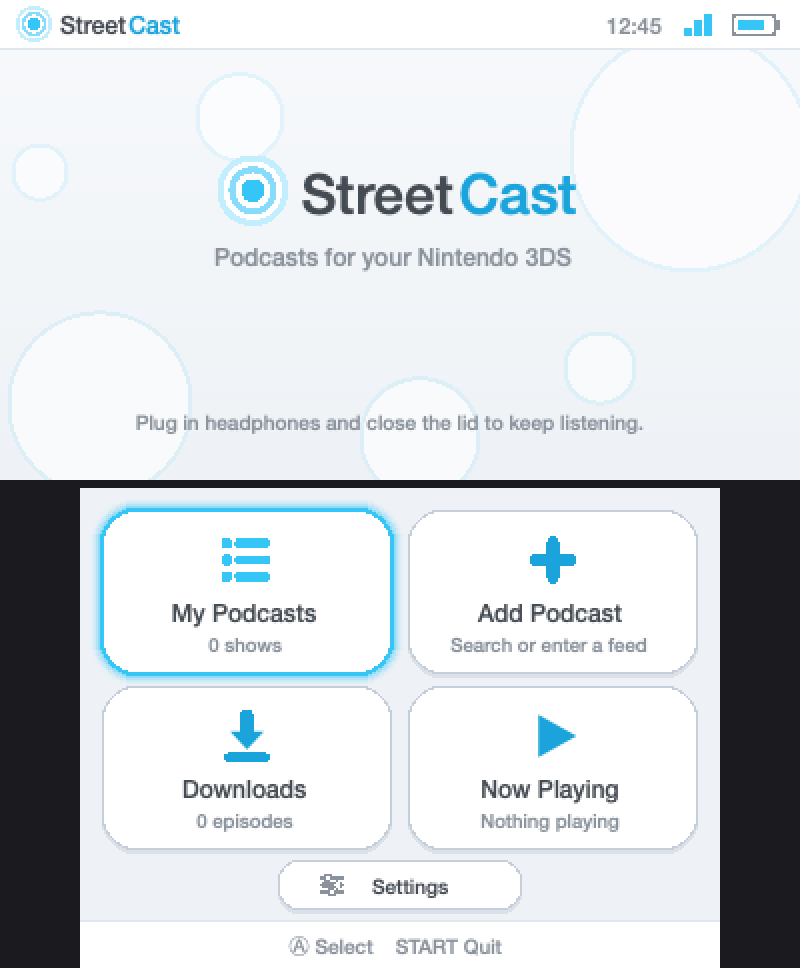
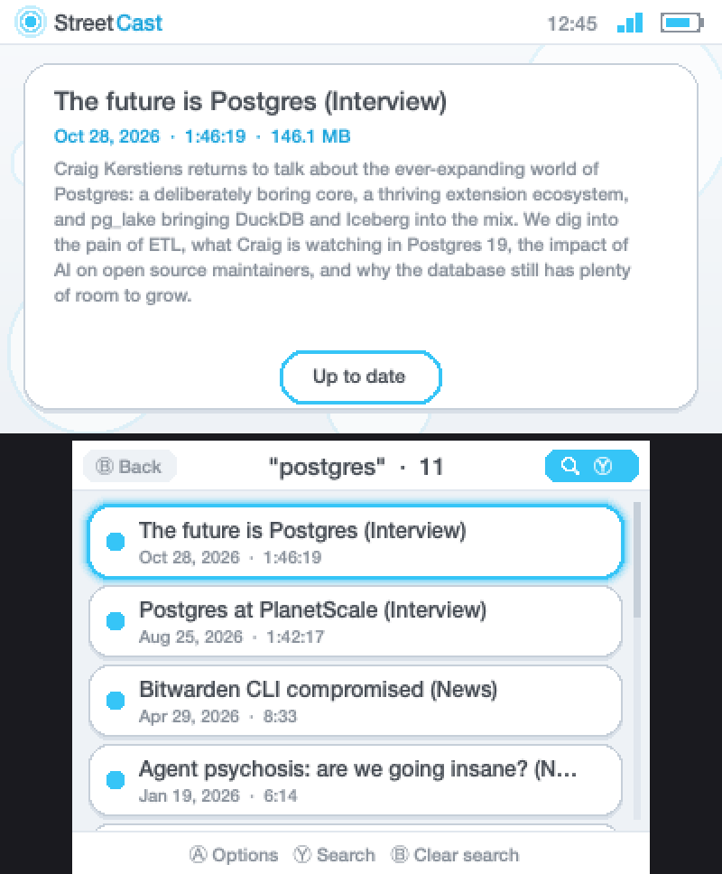
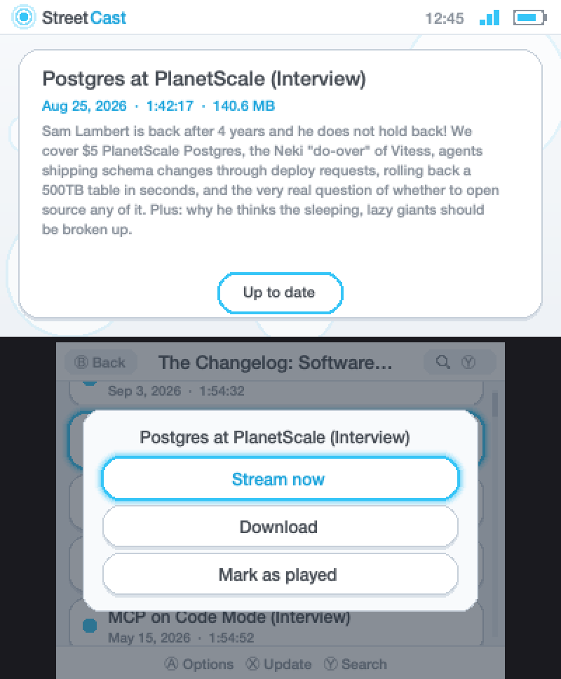
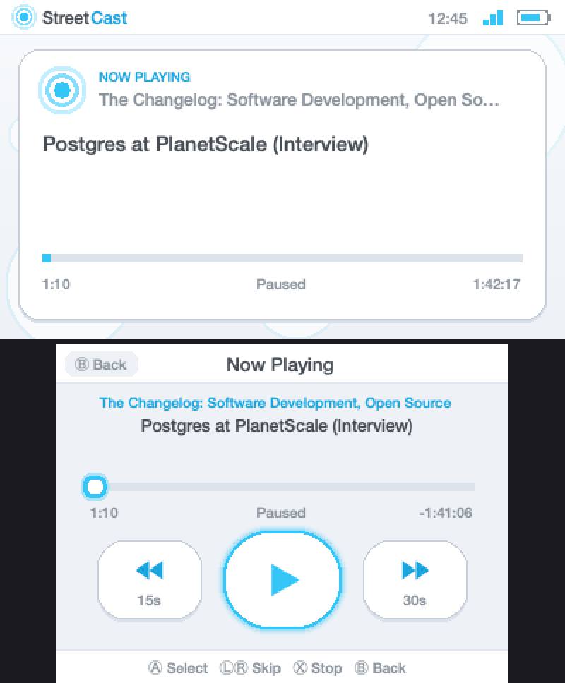

# StreetCast

A podcast player for the Nintendo 3DS, in the style of the Wii and 3DS system menus: white
bubbly buttons with a glowing blue outline. Subscribe to RSS feeds, stream episodes, or
download them to the SD card, and keep listening with the lid shut. The name is a nod to
StreetPass.

| Home | Episode search |
| --- | --- |
|  |  |

| Episode options | Now Playing |
| --- | --- |
|  |  |

*Screenshots come from the desktop preview harness (see [Tests](#tests)), which uses a
different font and renderer from the console, so details differ slightly on a real 3DS.*

## Status

**Early and experimental.** StreetCast has been run on real hardware only briefly: the
interface comes up, but network requests have failed there for a reason not yet diagnosed, and
audio playback has not been confirmed on a console. The feed parser, networking, streaming,
downloads and all of the app logic are tested on a desktop against live feeds. Expect bugs,
and please open an issue with a photo of any error (network errors end in a code like `[E60]`).

## Features

- **Subscribe** three ways: search the podcast directory by name, type an RSS feed address,
  or list addresses in a text file on the SD card and import them all.
- **Stream** episodes over Wi-Fi, with seeking, automatic reconnects and rebuffering.
- **Download** episodes to the SD card for offline listening. Downloads run in the background
  one at a time, show progress, and resume where they stopped.
- **Lid-closed listening**: with headphones plugged in, playback (and downloads) continue with
  the console shut and the screens off. Buttons are ignored while it is shut, so nothing skips
  in a pocket.
- **Remembers your place** in every episode, and marks finished episodes as played.
- **Search inside a list**: filter a podcast's episodes, or your downloads, by words in the
  title or description.
- **Skip back / forward** with L and R from any screen (10/15/30 s back, 15/30/45/60 s forward).
  Hold L for 3 seconds to restart the episode; hold R for 5 seconds to jump to the next one.
- **Touch or buttons**: every screen works with the D-Pad and A/B, or by tapping and dragging.
- **Light and dark themes**: in Settings choose Light, Dark (white surfaces become black), or
  Auto, which follows the console's clock: light from 8am to 5pm, dark from 5pm to 8am.
- **Top screen** shows the selected episode's details, or what's playing, with clock, Wi-Fi and
  battery.

### Limits

- **MP3 only.** Episodes published as AAC/M4A are labelled "Not MP3" and can't be played.
- Each podcast shows its newest 300 episodes; up to 64 subscriptions.
- Pressing HOME suspends audio.

## Install

You need a 3DS with custom firmware (Luma3DS) and the Homebrew Launcher.

1. Download `StreetCast.3dsx` from the [Releases](../../releases) page.
2. Copy it to the `/3ds/` folder on the SD card.
3. Start it from the Homebrew Launcher.

Sound needs the DSP firmware dump at `/3ds/dspfirm.cdc`. If StreetCast says sound isn't
available, open the Rosalina menu (L + D-Pad Down + Select), choose
**Miscellaneous options > Dump DSP firmware**, then restart StreetCast.

Make sure the console is connected to Wi-Fi and its date and time are correct; a wrong clock
breaks secure (HTTPS) connections.

## Using it

| Where | Controls |
| --- | --- |
| Everywhere | **A** select, **B** back, **L / R** skip back / forward, hold **L** 3 s restart episode, hold **R** 5 s next episode, **SELECT** jump to Now Playing, **START** quit |
| My Podcasts | **A** open, **X** update all, **Y** options (update / unsubscribe) |
| Episode list | **A** options (stream, download, mark played), **X** check for new episodes, **Y** search |
| Downloads | **A** options (play, delete, cancel), **Y** search |
| Now Playing | **A** play / pause, **X** stop, D-Pad to pick a button, touch the bar to scrub |

In a search, **B** clears it. START asks before quitting if downloads are running.

"Next episode" means the one listed below the playing episode in the list you started it from
(the next older episode in a podcast, or the next item in Downloads). L and R do nothing while
the lid is closed.

### Adding podcasts from a computer

Typing addresses on a 3DS is slow. Instead, put one feed address per line in
`/3ds/StreetCast/feeds.txt` on the SD card (StreetCast creates the file on first run), then
choose **Add Podcast > Import feeds.txt**.

### Listening with the lid closed

This works like the built-in Nintendo 3DS Sound app: the console mutes its speakers when shut,
so playback continues **only with headphones plugged in**. StreetCast refuses the system's
sleep request while audio is playing, turns the screen backlights off itself, and keeps Wi-Fi
from being handed over to StreetPass so streams keep flowing. Close the lid without headphones
and playback pauses and the console sleeps as usual.

The console stays awake while doing this, so the battery drains as if it were in use.

## Where things are kept

Everything lives in `/3ds/StreetCast/` on the SD card:

| Path | Contents |
| --- | --- |
| `feeds.txt` | Feed addresses to import |
| `subs.tsv` | Your subscriptions |
| `state.tsv` | Resume positions and played marks |
| `downloads.tsv`, `episodes/` | Downloaded episodes |
| `cache/` | Cached episode lists |
| `settings.txt` | Settings |

StreetCast only reads and writes inside that folder. It does not touch system storage.

## Building

Install [devkitPro](https://devkitpro.org/wiki/Getting_Started) with the 3DS toolchain and
these packages:

```sh
dkp-pacman -S 3ds-dev 3ds-curl 3ds-mbedtls 3ds-mpg123 3ds-zlib
make
```

This produces `StreetCast.3dsx`. The certificate bundle in `romfs/cacert.pem` is Mozilla's CA
list from <https://curl.se/ca/cacert.pem>; refresh it occasionally.

### How the code is laid out

| File | Role |
| --- | --- |
| `source/main.c` | Start-up, main loop, lid/sleep/backlight policy |
| `source/app.c` | Screens and app logic |
| `source/ui.c` | Buttons, glow, text layout, icons |
| `source/gfx_3ds.c` | citro2d drawing backend |
| `source/player.c`, `decoder.c` | Audio thread (NDSP) and MP3 decoding (mpg123) |
| `source/stream.c`, `net.c` | HTTP streaming buffer and downloads (libcurl + mbedTLS) |
| `source/feed.c` | RSS parser, episode cache, directory search results |
| `source/store.c`, `dl.c` | Saved data and the download queue |

## Tests

The portable parts build and run on a desktop:

- `tests/run.sh` checks the feed parser, networking and stream buffering against live feeds.
- `tests/preview.sh` (macOS) runs the real app logic end to end with a CoreGraphics renderer
  and a simulated audio player, and writes screenshots to `tests/out/shots/`.

## Credits

Built on [libctru](https://github.com/devkitPro/libctru), citro2d/citro3d,
[libcurl](https://curl.se), [Mbed TLS](https://www.trustedfirmware.org/projects/mbed-tls/)
and [mpg123](https://www.mpg123.de). Podcast search uses the iTunes Search API.

StreetCast is an unofficial homebrew project and is not affiliated with or endorsed by Nintendo.
